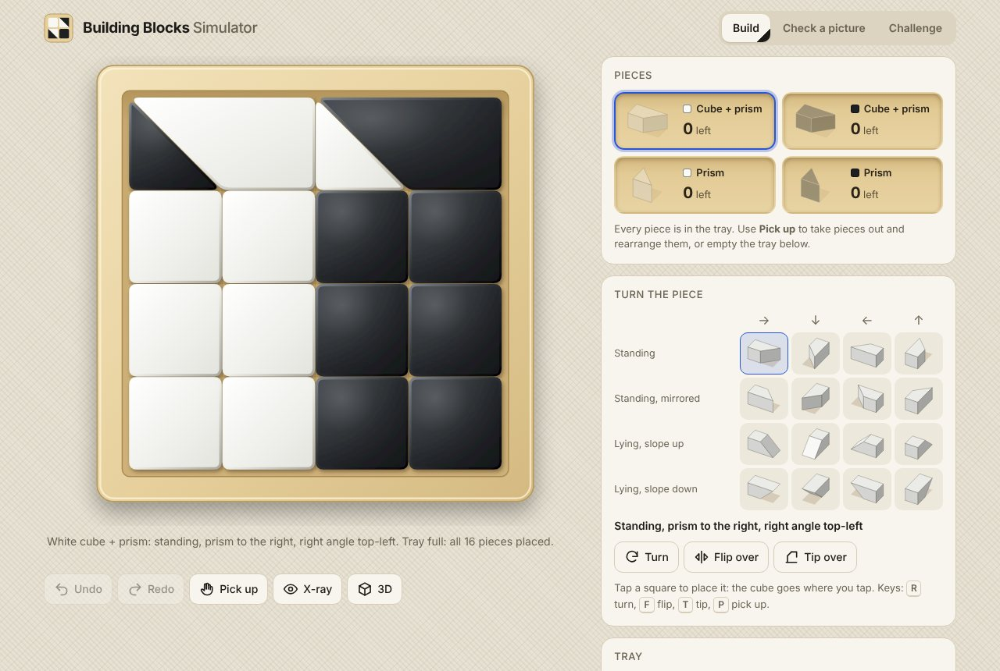
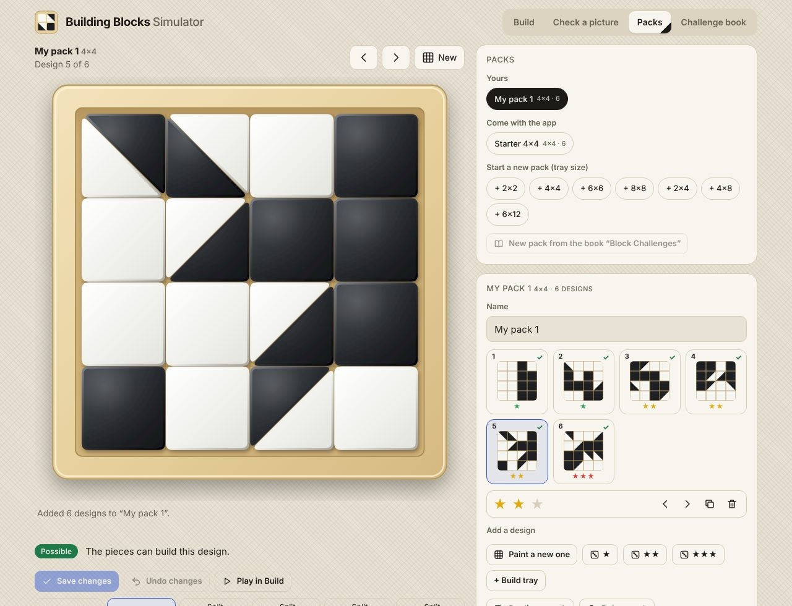
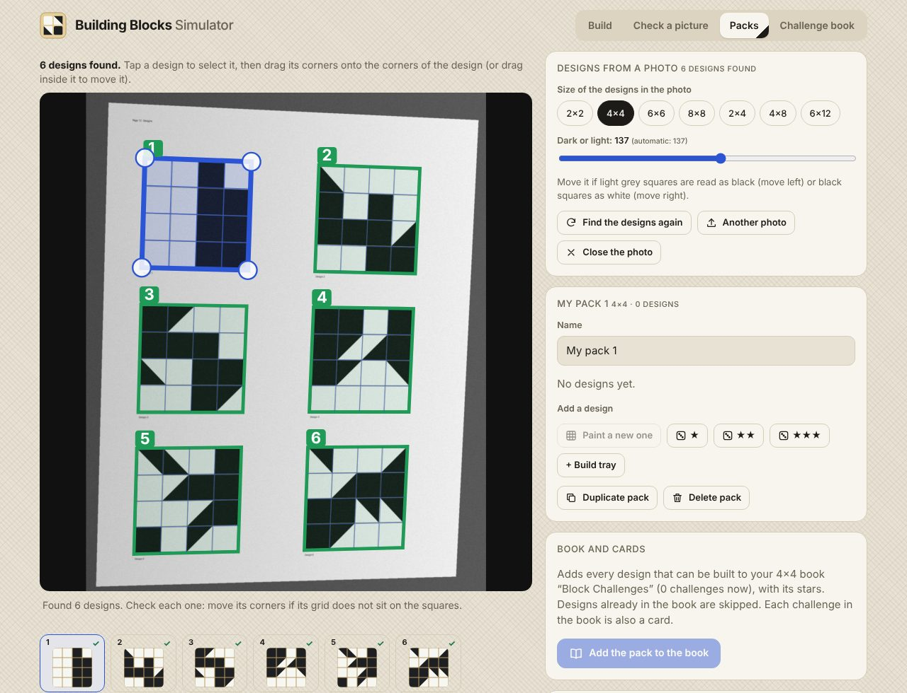
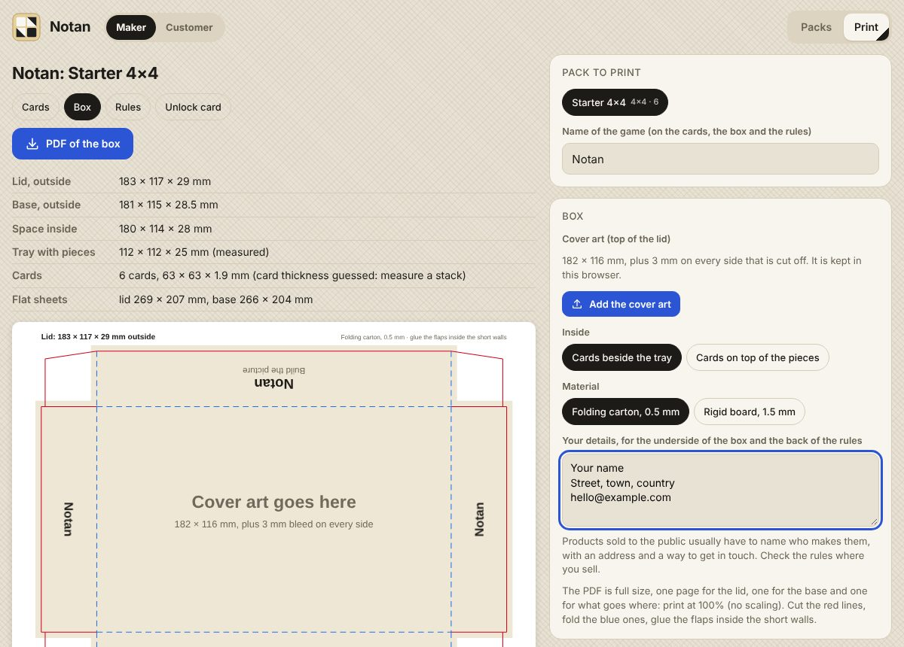
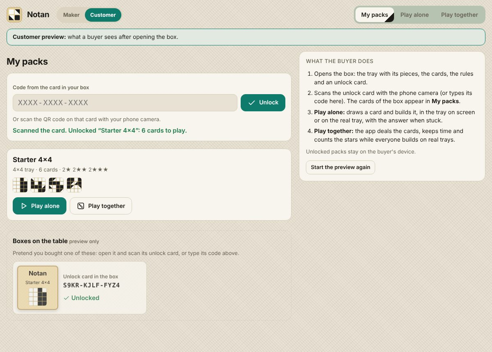
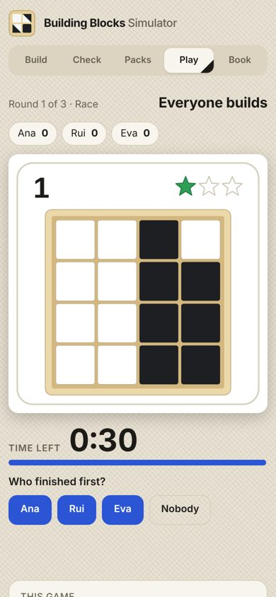
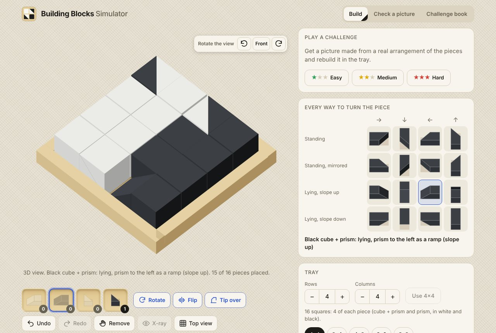

# Notan: Building Blocks Simulator

The app behind **Notan**, a black-and-white block puzzle: a tan tray filled with white and black
**cube + prism** pieces and loose **prisms** (half cubes), and cards of pictures to build with
them. It has two sides:

- **Maker** (yours): make the **packs** of designs you sell, one pack per box, and **print**
  everything that goes in the box: the cards, the box itself, the rules leaflet and the unlock
  card.
- **Customer** (a preview of what a buyer gets): unlock the pack in the box, then play it
  **alone** (build the cards in a tray on screen, every way the real pieces turn) or
  **together** (the app deals the cards, keeps time and score while everyone builds on real
  trays).



**Try it:** open [`index.html`](index.html) in a browser. It is one self-contained file
(no install, works offline, fonts fall back to system fonts).

## How the pieces work

| | |
|---|---|
| **Set per 2 squares** | One cube + prism (a cube with a triangular prism glued to one face) and one loose prism. Half of each kind is white, half black, so a tray needs a multiple of 4 squares (4×4 has 4 of each, 8×4 has 8 of each). |
| **Loose prism** | Can stand on its triangle (seen from above: a triangle in one of 4 corners), lie as a **ramp** (slope up), or lie as a **roof** (slope down, flat top). 12 orientations. A loose roof needs a ramp under it. |
| **Cube + prism** | The cube fills a square; the prism goes into the next square, standing (2 mirror images), as a ramp, or as a roof with a hollow underneath that a ramp can fill. 4 directions × 4 poses = 16 orientations. |
| **A full square** | Either a cube, or two halves that fit together: two standing triangles (a diagonal split), or a ramp with a roof on top (looks like a plain square). |

This explains the photos: almost every square looks plain because each cube + prism lies
as a ramp with a loose prism on top as a roof. It also explains why some pictures are
impossible: each cube always shows as a full square, so **at most half the squares can show
a diagonal split**. A picture made only of triangles can never be built.

## What you can do

Switch between **Maker** and **Customer** at the top of the app.

### Maker › Packs

A pack is a named set of designs for one tray (4×4 or 4×8): the cards of one box.

- **Make and change packs**: start a new pack, or copy one. Tap a design to show it in the tray
  and paint over it. Every design is checked as you paint, and only designs the pieces can
  build are saved. **How to build it** shows one way in 3D (see below). Add designs by
  painting or at random (★, ★★, ★★★), set their stars, reorder, duplicate or delete them.
  **Try it as a buyer** opens the design on the customer side.
- **Designs from a photo**: take a photo of a page of a book of designs. The designs are
  found and read; each one is shown on the photo with its grid, and squares that were hard
  to read are marked. Drag a design's corners to fix it, mark a missed one by hand, change
  the size or the dark/light setting, then add the ones you want to a pack. Designs that
  cannot be built are not ticked.
- **Saved to your account**: when the app runs as a Claude artifact, the packs are kept in the
  artifact's database ([`src/packstore.js`](src/packstore.js)). They survive a cleared browser,
  show on every device, and Claude can read them, so "add my packs to the app" needs no copying.
  Elsewhere they stay in the browser. Packs can also be saved as `.json` files and opened again.
- **Packs that come with the app** are the files in [`packs/`](packs), one pack per file,
  read when the app is built. The tests check that every design in them can be built.
- **Stars**: a design has 1 to 5 stars (easy, medium, hard, expert, master). Cards show three
  star slots, or five when the pack has a design with more than three stars.
- **Packs from the book**: [`book/`](book) holds the designs read from photos of the book
  (with their book number and stars). `node scripts/book-packs.mjs` makes as many packs as it
  can with **9 designs of each star level** (45 cards for five levels), spread over the book,
  writes them to `packs/book-<size>-<n>.json` and lists the designs left over.





### Maker › Print

Everything that goes in the box of a pack, as PDFs:

- **Cards**: one card per design, in the shape of the tray (6.3 × 6.3 cm for 4×4, 8.8 × 4.4 cm
  for 4×8) with its number, stars and picture. 12 cards on a portrait sheet with cut marks, and
  the card back (the game's name and the pack's) on the next page. Print on both sides, flip on
  the long edge, cut.
- **Box**: a base and a full-depth lid that hold the tray with its pieces, the cards and the
  rules, sized from the measured trays (4×4: 112 × 112 mm, 4×8: 205 × 112 mm, 25 mm high with
  the pieces in). The name is on all four sides of the lid, upright once folded; the underside
  of the base says what is inside, how to get the digital pack, and who made it. The **cover
  art** on the lid comes from [`art/`](art): each box takes the picture closest to its lid's
  shape, with 3 mm bleed, and a sketch shows the closed box.
  Cards beside the tray or on top; folding carton or rigid board. Full-size PDF: lid, base, and
  what goes where (red: cut, blue dashed: fold).
- **Rules**: the leaflet that replaces the book (the cards hold the pictures): four 95 mm pages
  folded from one strip: the cover, the pieces and the goal, the ways to play, and the digital
  pack with your details. Two leaflets per sheet.
- **Unlock card**: the card with the code that unlocks the pack in the app, and its QR code.
  For now a sample code; a list of real codes (one per box) can be opened once they exist.



### Customer › My packs, Play alone, Play together

A preview of the buyer's app, in its own colour:

- **My packs**: every pack you have is a "box on the table" with its unlock card. Scan the card
  (one tap here) or type its code, and the pack's cards appear. The code box takes the code in
  any form, with or without hyphens, in lower case, or pasted along with other text.
- **Play alone**: draw a card from your packs and build its picture in the tray: wrong squares
  are outlined in red, *Show answer* opens the 3D guide below the card (and can put the answer
  in your tray). Drag pieces onto the tray, **Rotate**,
  **Flip** or **Tip over** them, then **Place**; tap a piece in the tray to select it (tap again
  for the one under it). There is a 3D view, x-ray (ramps under roofs), undo and redo.
- **Play together**: the app is the game master while everyone builds on real trays.
  - **Time trial:** players take turns drawing a card and building it before the clock runs
    out; a card built in time scores its stars.
  - **Memory:** the card is shown for a few seconds, then hidden; build it from memory, then
    compare.
  - **Race:** one card for everyone, each on their own tray; the first to finish scores it.

  Choose the players (up to 8), the packs, the rounds and the time per card. The game keeps the
  screen awake, beeps when time runs out, shows a solution after each card, and survives a page
  reload.

**One way to build it**, wherever a solution is shown (Packs, Play alone, Play together): a 3D
tray you can turn in 45° steps, and **Build it piece by piece**: the pieces go in one at a
time, those that lie on the floor first and the roofs last, so the ramps hidden under the roofs
are seen going in. Each step names the piece and how it lies.

To sell for real (the buyer's app online, one code per box), see
[docs/going-live.md](docs/going-live.md).







Keys (Play alone): <kbd>1</kbd>–<kbd>4</kbd> take a piece, <kbd>R</kbd> rotate, <kbd>F</kbd>
flip, <kbd>T</kbd> tip over, <kbd>Enter</kbd> place, <kbd>Delete</kbd> remove the selected
piece, <kbd>Esc</kbd> cancel, <kbd>X</kbd> x-ray, <kbd>V</kbd> 3D, <kbd>Ctrl</kbd>+<kbd>Z</kbd> /
<kbd>Ctrl</kbd>+<kbd>Y</kbd> undo/redo. On the tray, the arrow keys move the selected piece
(or a cursor, and <kbd>Enter</kbd> selects the piece under it).

The earlier version, with a free building sandbox, a *Check a picture* tab, the challenge book
and encrypted unlock codes, is kept in the
[`full-version`](https://github.com/gleal42/building-blocks-simulator/tree/full-version) branch.

## Development

```sh
npm install
npm test          # model, solver, pack, pack store, photo, game, print and code tests (QR codes are read back with a QR reader)
npm run build     # bundles src/ and the packs in packs/ into index.html
npm run dev       # rebuilds index.html whenever src/ or packs/ changes
```

`index.html` is generated: edit the files in `src/` and rebuild. CI runs the tests and
fails if `index.html` is out of date.

| File | What it does |
|---|---|
| `src/geometry.js` | The 12 half-cube shapes, the 16 cube + prism orientations, what a square looks like from above, 3D solids. |
| `src/board.js` | Tray model: placing (no overlap, only complementary halves share a square, loose roofs need a ramp), removing, top-view looks, board codes. |
| `src/solver.js` | Decides whether a picture can be built and returns an arrangement; random arrangements. |
| `src/packs.js`, `src/builtinpacks.js`, `packs/` | Packs of designs: the file format, checks, stars, and the packs that come with the app. |
| `book/`, `scripts/book-packs.mjs` | The designs read from the book, and the script that makes packs of 9 per star level from them. |
| `src/packstore.js` | Keeps the packs in the artifact's database, in step across devices. |
| `src/packui.js`, `src/packcheck.js` | The Packs tab, and checking designs in a background worker. |
| `src/photo.js` | Finding and reading designs in a photo. |
| `src/printui.js` | The Print tab. |
| `src/coverart.js`, `art/` | The box cover art, built into the page. |
| `src/cards.js`, `src/box.js`, `src/leaflet.js` | The cards and unlock cards, the box (sizes, flat shapes to cut), the rules leaflet; each as a preview and a PDF. |
| `src/drawing.js`, `src/pdf.js`, `src/fonts.js` | Shapes that become SVG or PDF, a small PDF writer (vector shapes, Helvetica text, JPEG pictures) and font widths. |
| `src/links.js`, `src/qr.js` | Unlock codes (sample codes, reading a code out of any text), unlock links, and QR codes as drawings. |
| `src/customerui.js` | My packs, on the customer side. |
| `src/solutionview.js` | One way to build a picture: 3D, piece by piece, in the order the pieces can go in. |
| `src/game.js`, `src/playui.js` | Games: the deck, turns, timing and scores (also the deck for playing alone), and Play together. |
| `src/render2d.js`, `src/render3d.js` | Photo-style top view; 3D icons and the clickable 3D tray. |
| `src/presets.js` | The two photos as layouts (used by the tests). |
| `src/app.js`, `src/styles.css`, `src/index.html` | The app: the two sides, Play alone, saving. |
| `src/worker.js` | Runs the solver in a Web Worker. |

### How the checker works

Exactly as many squares hold a cube as there are cube + prism pieces; every other square
holds two complementary halves, each coming from a neighbouring cube or a loose prism. The
solver first applies quick counting rules (too many split squares, not enough white or
black pieces for the picture), then sweeps the board row by row, passing "a prism arrives
here" and "a prism must come from there" messages between neighbouring squares and
remembering dead ends. It tries the board in several mirrored and turned directions plus
randomised restarts; a sweep that finishes without an arrangement has ruled out every
possibility. The tests compare it with a brute-force search over every arrangement of the
real pieces on 2×2, 1×4 and 2×4 trays. Very large, busy pictures can come back as
"couldn't decide"; the Packs tab then searches longer in the background.

### How designs are read from a photo

The photo is turned grey and split into dark ink and light paper (Otsu's threshold, or the
slider). Dark areas are joined into designs: a design drawn with a frame or grid lines is
one area; one drawn as bare black squares breaks into parts, which are joined while they
still fit in one tray. Each design gets four corners (from its most extreme ink, which
follows a frame even in a slanted photo), and the corners are mapped onto the tray's rows and
columns. Both diagonals cut each square into four triangles; how dark each triangle is tells
white, black, or which of the four splits it shows. Squares that fit no look well are marked
as unsure.

## Third-party code

QR codes are made with [qrcode-generator](https://github.com/kazuhikoarase/qrcode-generator)
by Kazuhiko Arase (MIT license; its notice is kept in the built pages). "QR Code" is a
registered trademark of DENSO WAVE INCORPORATED. The tests read QR codes back with
[jsQR](https://github.com/cozmo/jsQR) (Apache-2.0, tests only).
