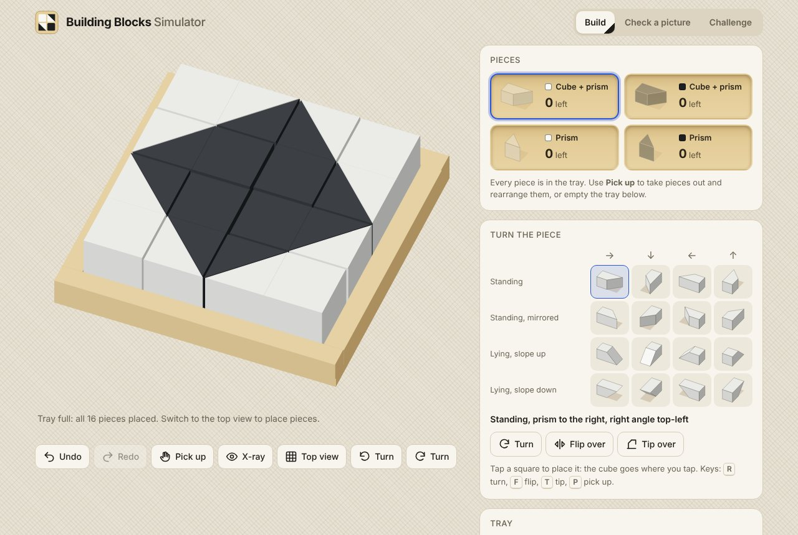

# Building Blocks Simulator

A simulator for the black-and-white block puzzle: a tan tray filled with white and black
**cube + prism** pieces and loose **prisms** (half cubes). Place and turn the pieces every
way the real ones can go, check whether a picture can be made, and play challenges.


**Try it:** open [`index.html`](index.html) in a browser. It is one self-contained file
(no install, works offline, fonts fall back to system fonts). To publish it with GitHub
Pages, turn Pages on for the `master` branch, root folder.

## How the pieces work

| | |
|---|---|
| **Set per 2 squares** | One cube + prism (a cube with a triangular prism glued to one face) and one loose prism. Half of each kind is white, half black, so a tray needs a multiple of 4 squares (4×4 has 4 of each, 8×4 has 8 of each). |
| **Loose prism** | Can stand on its triangle (seen from above: a triangle in one of 4 corners), lie as a **ramp** (slope up), or lie as a **roof** (slope down, flat top). 12 orientations. A loose roof needs a ramp under it. |
| **Cube + prism** | The cube fills a square; the prism goes into the next square, standing (2 mirror images), as a ramp, or as a roof with a hollow underneath that a ramp can fill. 4 directions × 4 poses = 16 orientations. |
| **A full square** | Either a cube, or two halves that fit together: two standing triangles (a diagonal split), or a ramp with a roof on top (looks like a plain square). |

This explains the photos: almost every square looks plain because each cube + prism lies
as a ramp with a loose prism on top as a roof. It also explains why some pictures are
impossible: each cube always shows as a full square, so **at most half the squares can show
a diagonal split**. A picture made only of triangles can never be built.


## What you can do

- **Build**: tap a piece in the parts bin, pick one of its orientations (3D icons show
  standing pieces, ramps and roofs), and tap a square. The cube goes where you tap. *Pick up*
  (or right-click) takes a piece out; a roof resting on a ramp comes out with it.
  Undo/redo, *X-ray* (see ramps hidden under roofs), *3D* view with turning, the two photo
  layouts as presets, random fill, and board codes to save or share a layout.
- **Check a picture**: paint squares white, black, split (4 ways) or "any", then check. You
  get *Possible* with a button that builds one arrangement in the tray, or *Impossible* with
  the reason. The search runs in the background; very large, busy pictures (12×12) can come
  back as "couldn't decide".
- **Challenge**: rebuild a picture made from a random real arrangement (easy, medium, hard).
- **Tray sizes** from 1 to 12 rows and columns, as long as the number of squares is a
  multiple of 4.

Keys: <kbd>R</kbd> turn, <kbd>F</kbd> flip over, <kbd>T</kbd> tip over, <kbd>1</kbd>–<kbd>4</kbd>
choose a piece, <kbd>P</kbd> pick up, <kbd>X</kbd> x-ray, <kbd>V</kbd> 3D, <kbd>Ctrl</kbd>+<kbd>Z</kbd> /
<kbd>Ctrl</kbd>+<kbd>Y</kbd> undo/redo, arrow keys + <kbd>Enter</kbd> on the tray.

<p>
  
  
</p>

## Development

```sh
npm install
npm test          # model and solver tests, including exhaustive cross-checks
npm run build     # bundles src/ into index.html
npm run dev       # rebuilds index.html whenever src/ changes
```

`index.html` is generated: edit the files in `src/` and rebuild. CI runs the tests and
fails if `index.html` is out of date.

| File | What it does |
|---|---|
| `src/geometry.js` | The 12 half-cube shapes, the 16 cube + prism orientations, what a square looks like from above, 3D solids. |
| `src/board.js` | Tray model: placing (no overlap, only complementary halves share a square, loose roofs need a ramp), removing, top-view looks, board codes. |
| `src/solver.js` | Decides whether a picture can be built and returns an arrangement; random arrangements. |
| `src/presets.js` | The two photos as layouts. |
| `src/render2d.js`, `src/render3d.js` | Photo-style top view; 3D icons and 3D tray view. |
| `src/app.js`, `src/styles.css`, `src/index.html` | The app. |
| `src/worker.js` | Runs the solver in a Web Worker. |

### How the checker works

Exactly as many squares hold a cube as there are cube + prism pieces; every other square
holds two complementary halves, each coming from a neighbouring cube or a loose prism. The
solver first applies quick counting rules (too many split squares, not enough white or
black pieces for the picture), then sweeps the board row by row, passing "a prism arrives
here" and "a prism must come from there" messages between neighbouring squares and
remembering dead ends. It tries the board in several mirrored and turned directions plus
randomised restarts; a sweep that finishes without an arrangement has ruled out every
possibility. The tests compare it with a brute-force search over every arrangement of the
real pieces on 2×2, 1×4 and 2×4 trays.
