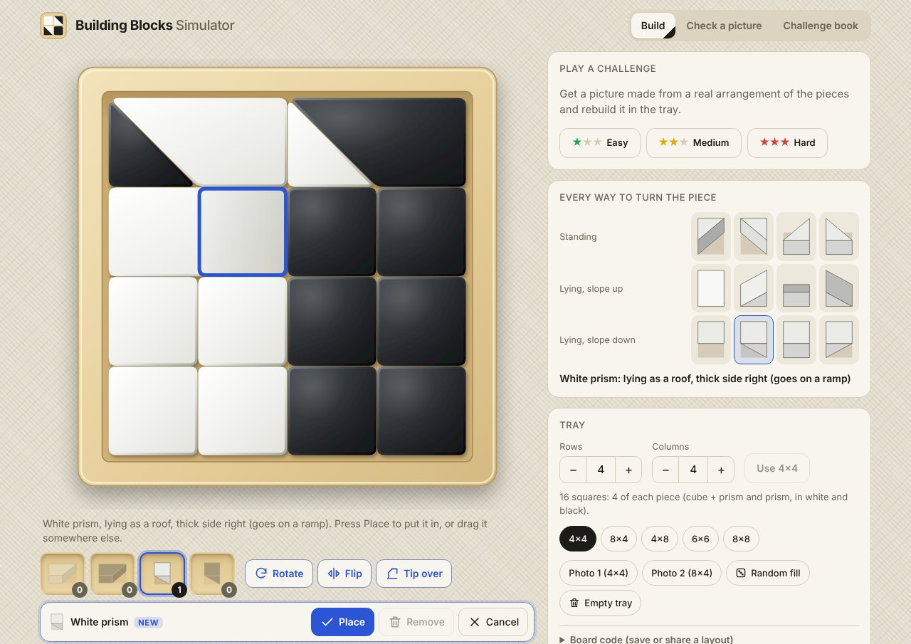
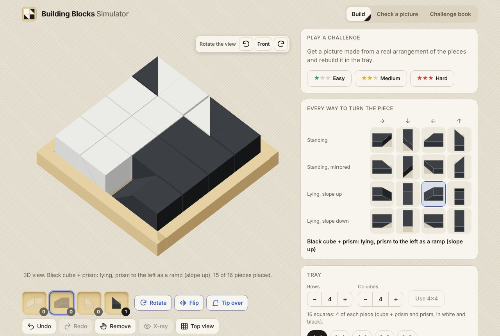
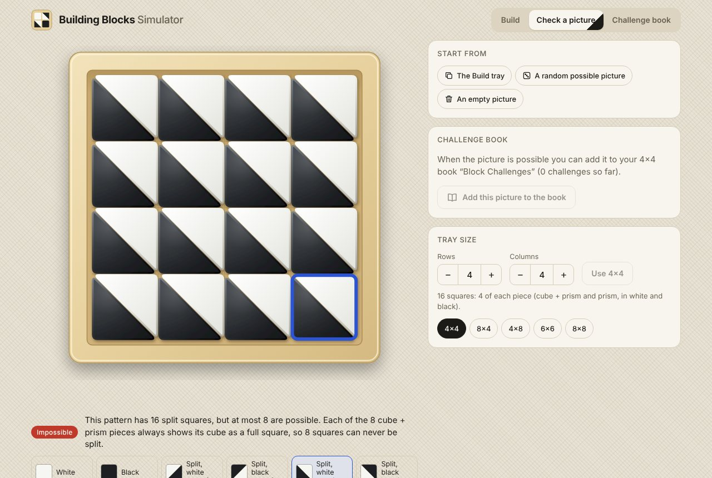
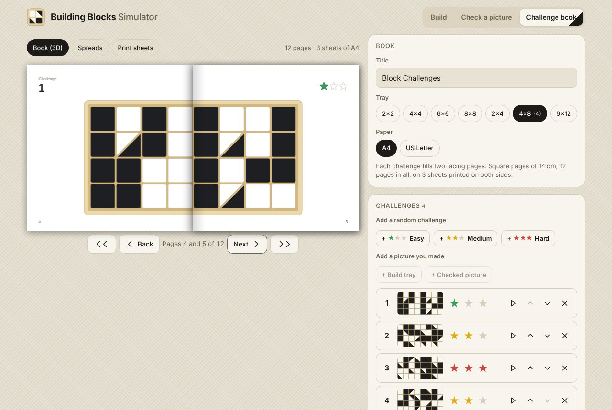
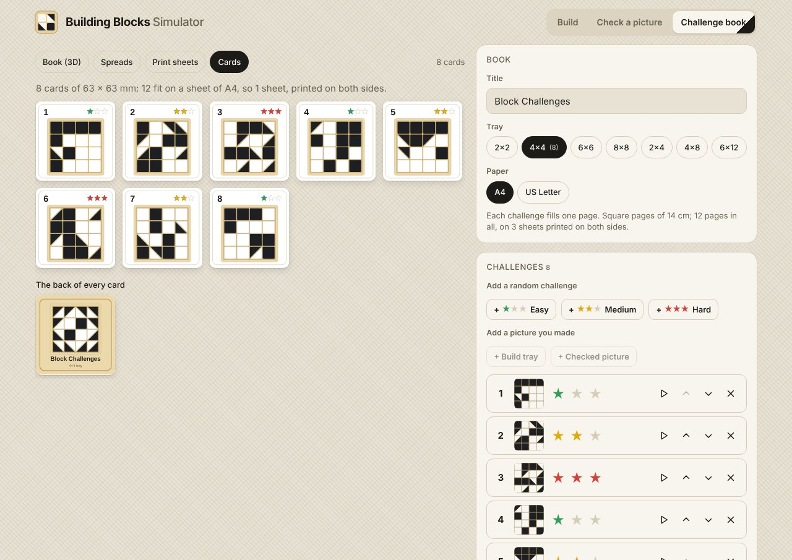
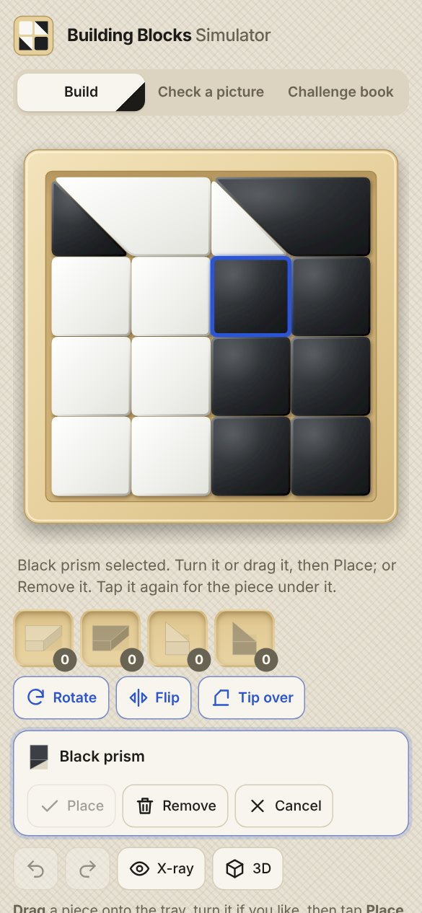

# Building Blocks Simulator

A simulator for the black-and-white block puzzle: a tan tray filled with white and black
**cube + prism** pieces and loose **prisms** (half cubes). Place and turn the pieces every
way the real ones can go, check whether a picture can be made, and make a printable
challenge book.



**Try it:** open [`index.html`](index.html) in a browser. It is one self-contained file
(no install, works offline, fonts fall back to system fonts). To publish it with GitHub
Pages, turn Pages on for the `master` branch, root folder.

## How the pieces work

| | |
|---|---|
| **Set per 2 squares** | One cube + prism (a cube with a triangular prism glued to one face) and one loose prism. Half of each kind is white, half black, so a tray needs a multiple of 4 squares (4×4 has 4 of each, 8×4 has 8 of each). |
| **Loose prism** | Can stand on its triangle (seen from above: a triangle in one of 4 corners), lie as a **ramp** (slope up), or lie as a **roof** (slope down, flat top). 12 orientations. A loose roof needs a ramp under it. |
| **Cube + prism** | The cube fills a square; the prism goes into the next square, standing (2 mirror images), as a ramp, or as a roof with a hollow underneath that a ramp can fill. 4 directions × 4 poses = 16 orientations. |
| **A full square** | Either a cube, or two halves that fit together: two standing triangles (a diagonal split), or a ramp with a roof on top (looks like a plain square). |

This explains the photos: almost every square looks plain because each cube + prism lies
as a ramp with a loose prism on top as a roof. It also explains why some pictures are
impossible: each cube always shows as a full square, so **at most half the squares can show
a diagonal split**. A picture made only of triangles can never be built.

## What you can do

### Build

- **Drag** a piece from under the tray onto it. It shows where it would go (outlined in red
  if it does not fit, with the reason under the tray). **Rotate**, **Flip** or **Tip over**
  it there, drag it again or tap another square, then press **Place**. Tapping a piece under
  the tray and then a square works too. All 16 or 12 orientations are also shown as
  pictures in the panel.
- **Tap or click a piece in the tray to select it.** Where a roof lies on a ramp, the first
  tap selects the roof, the next one the ramp under it, then the roof again. With a piece
  selected: **Remove** takes it out; turning or dragging it shows it at its new place (it
  stays faded where it was) until you press **Place**; **Cancel** leaves everything as it
  was. Right-click (or Ctrl + click) removes a piece straight away.
- **3D view** works the same way, on phones too. The buttons above the tray turn the view in
  45° steps. On a phone, a swipe that starts beside or above the 3D tray scrolls the page;
  one that starts on the tray stays with the tray.
- *X-ray* shows ramps hidden under roofs. Undo/redo, the two photo layouts, random fill,
  tray sizes from 1 to 12 rows and columns (a multiple of 4 squares), and board codes.
- **Challenges** (easy ★, medium ★★, hard ★★★): rebuild a picture made from a random real
  arrangement. The picture stays above the tray; wrong squares are outlined in red.



### Check a picture

Paint squares white, black, split (4 ways) or erase them (right-click erases). The answer
appears as you paint: *Possible* (with a button that builds one arrangement in the tray),
or *Impossible* with the reason. Possible pictures can be added to the challenge book.



### Challenge book

- Books for square trays (2×2 to 8×8, one challenge per page) and 2:1 trays (2×4 to 6×12,
  one challenge across two facing pages). Each tray size keeps its own book.
- Add random challenges by difficulty, the Build tray, or a checked picture. Change the
  stars (green easy, yellow medium, red hard), reorder, delete, or play a challenge in Build.
- Default front and back covers (the back lists every challenge), or upload your own
  pictures.
- Preview as a **3D book** with pages to turn, as flat **spreads**, as the **print sheets**,
  or as **cards**.
- **PDF to print as a booklet**: square pages (14 cm on A4, 13 cm on US Letter), two per
  sheet side, in saddle-stitch order. Sheet 1 has the back and front covers on the outside
  and the first and last pages on the inside. Print on both sides (flip on the short edge),
  stack, fold, staple on the fold, and trim to the corner marks. There is also a PDF with one
  page per page, for a print shop or a screen.
- **Cards**: a deck with one card per challenge, in the shape of the tray (6.3 × 6.3 cm for
  square trays, 8.8 × 4.4 cm for 2:1 trays) with its number, stars and picture, for players
  to draw a card and build it. The PDF puts 12 cards on a portrait sheet (10 for 2:1 cards on
  US Letter) with cut marks, and the shared card back on the next page: print on both sides,
  flip on the long edge, and cut.
- **Save book (.json)** keeps the challenges, stars, answers, title and covers;
  **Open a saved book** carries on where you left off.







Keys: <kbd>1</kbd>–<kbd>4</kbd> take a piece, <kbd>R</kbd> rotate, <kbd>F</kbd> flip,
<kbd>T</kbd> tip over, <kbd>Enter</kbd> place, <kbd>Delete</kbd> remove the selected piece,
<kbd>Esc</kbd> cancel, <kbd>X</kbd> x-ray, <kbd>V</kbd> 3D, <kbd>Ctrl</kbd>+<kbd>Z</kbd> /
<kbd>Ctrl</kbd>+<kbd>Y</kbd> undo/redo. On the tray, the arrow keys move the selected piece
(or a cursor, and <kbd>Enter</kbd> selects the piece under it). Arrow keys turn the pages of
the book.

## Development

```sh
npm install
npm test          # model, solver and book tests, including exhaustive cross-checks
npm run build     # bundles src/ into index.html
npm run dev       # rebuilds index.html whenever src/ changes
```

`index.html` is generated: edit the files in `src/` and rebuild. CI runs the tests and
fails if `index.html` is out of date.

| File | What it does |
|---|---|
| `src/geometry.js` | The 12 half-cube shapes, the 16 cube + prism orientations, what a square looks like from above, 3D solids. |
| `src/board.js` | Tray model: placing (no overlap, only complementary halves share a square, loose roofs need a ramp), removing, top-view looks, board codes. |
| `src/solver.js` | Decides whether a picture can be built and returns an arrangement; random arrangements. |
| `src/book.js` | Challenge books: pages, saddle-stitch imposition, saving and opening. |
| `src/bookpages.js` | Page layouts, drawn as shapes that become SVG (preview) or PDF (printing). |
| `src/pdf.js`, `src/fonts.js` | A small PDF writer (vector shapes, Helvetica text, JPEG covers) and font widths. |
| `src/presets.js` | The two photos as layouts. |
| `src/render2d.js`, `src/render3d.js` | Photo-style top view; 3D icons and the clickable 3D tray. |
| `src/app.js`, `src/bookui.js`, `src/styles.css`, `src/index.html` | The app. |
| `src/worker.js` | Runs the solver in a Web Worker. |

### How the checker works

Exactly as many squares hold a cube as there are cube + prism pieces; every other square
holds two complementary halves, each coming from a neighbouring cube or a loose prism. The
solver first applies quick counting rules (too many split squares, not enough white or
black pieces for the picture), then sweeps the board row by row, passing "a prism arrives
here" and "a prism must come from there" messages between neighbouring squares and
remembering dead ends. It tries the board in several mirrored and turned directions plus
randomised restarts; a sweep that finishes without an arrangement has ruled out every
possibility. The tests compare it with a brute-force search over every arrangement of the
real pieces on 2×2, 1×4 and 2×4 trays. Very large, busy pictures (12×12) can come back as
"couldn't decide"; *Search longer* gives the search more time.
